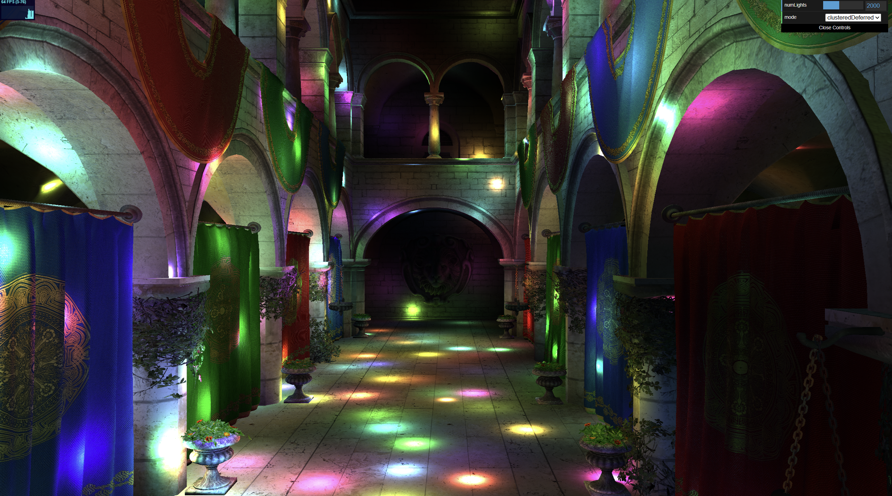
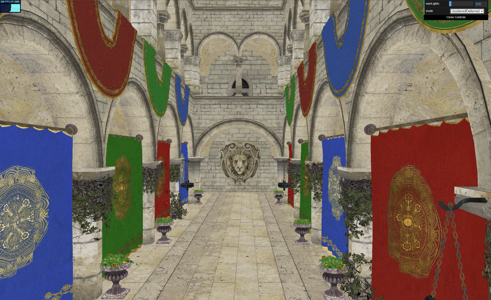
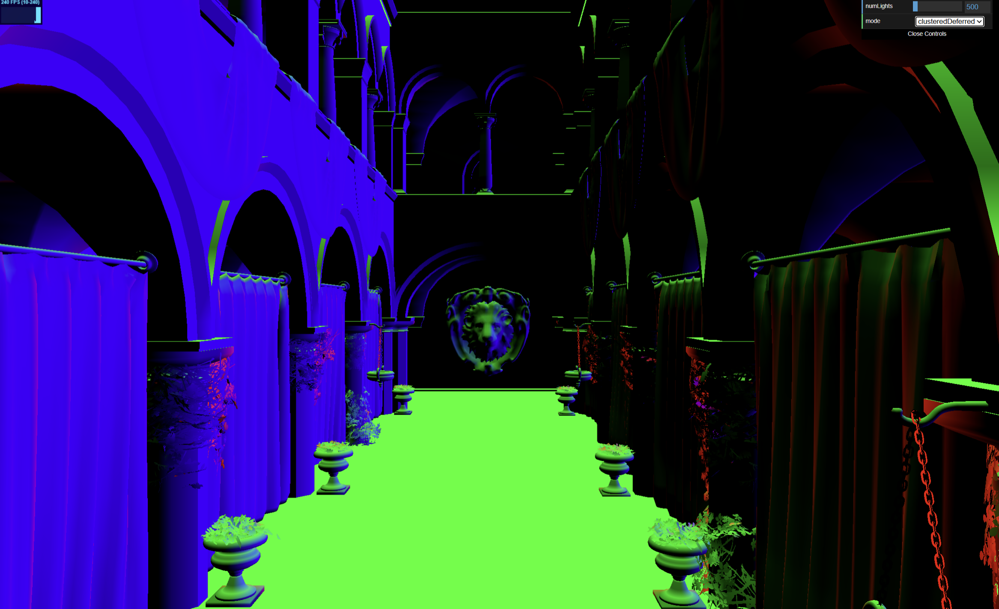
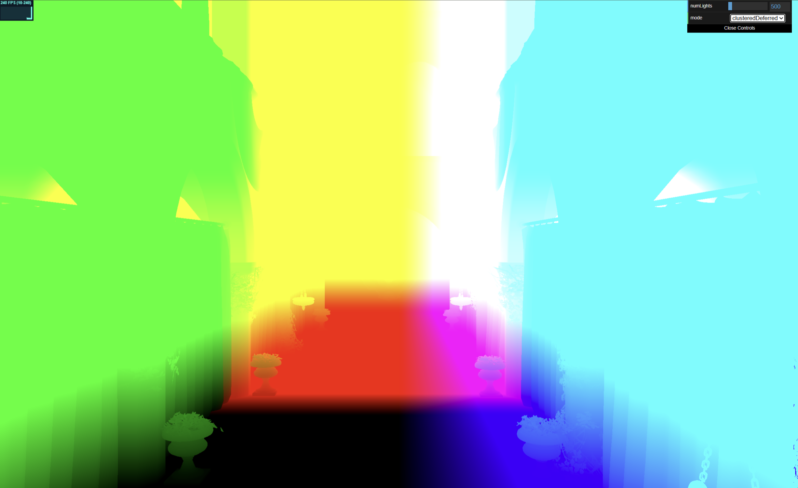

WebGL Forward+ and Clustered Deferred Shading
======================

**University of Pennsylvania, CIS 565: GPU Programming and Architecture, Project 4**

* Grace Tan
* Tested on: (TODO) **Google Chrome 222.2** on
 Windows 11 Home 25H2 (Build 26200), AMD Ryzen 9 8945HX @ 2.50GHz, 16GB RAM, NVIDIA GeForce RTX 5060 Laptop GPU 8GB

## Live Demo

## 
This project implements three different methods for computing lighting within a scene:
1. Naive Renderer
2. Forward+ Renderer
3. Clustered Deferred Renderer

We do this to explore how to improve upon the Naive Renderer, which iterates through every light in the scene to compute the total light contribution for each fragment.

## Video Demos

### Naive
https://github.com/user-attachments/assets/a544b983-bc3c-4a23-a1e7-de248013b8bc

The naive renderer is a standard forward renderer. Every geometry fragment loops over every light in the scene and accumulates its contribution. This is inefficient because not all lights contribute to the color of a given fragment. As pictured above, this works reasonably well for a small number of lights, but performance tends to scale poorly as the light count increases or the size of the scene increases. Fragments that are later overwritten by closer geometry (overdraw) also pay this full cost.

### Forward Plus
https://github.com/user-attachments/assets/70eb99d8-9558-41a0-9c6c-bcc7285d6c79

Forward+ adds a light culling pass before shading. The view frustum is divided into a 3D grid of clusters (x and y space-space tiles, z depth slices), and compute shaders build the axis-aligned bounding box in camera space and assign the corresponding lights for each cluster. 

The cluster grid is configurable. Smaller clusters overlap fewer lights, so shading is cheaper, but the culling pass has more clusters to test; larger clusters have the opposite tradeoff. Forward+ still shades every rasterized fragment, including ones that are later hidden by closer geometry. 

### Clustered Deferred
https://github.com/user-attachments/assets/356d6bb4-7a67-4c7d-8b91-dea4d62c9ef5

Clustered deferred uses the same cluster light culling as Forward+ but separates geometry from lighting. 
1. **G-buffer pass:** The scene geometry is rendered once in order to write per-pixel surface data (albedo, normal, and depth) to textures. Depth is used to calculate position in lighting pass (doing this avoids writing to a fourth position texture).
2. **Lighting pass** A fullscreen quad is drawn. For each pixel, the fragment shader reads the G-buffer, reconstructs the world position from depth, finds the pixel's cluster, and loops over only that cluster's lights.

Because the depth test has already resolved visibility, lighting runs exactly once per visible pixel and no work is wasted on occluded fragments. The cost of lighting no longer depends on scene complexity, only on screen resolution and light count. However, there are still tradeoffs: extra memory and bandwidth is the cost for writing and reading to the G-buffer textures. 

## Debugging Images 
To verify the success of the G-buffer pass, I rendered the data stored in the albedo, normal, and position (computed from depth) textures. 

<table>
  <tr>
    <td align="center">
       
      <em>Albedo</em>
    </td>
    <td align="center">
       
      <em>Normal</em>
    </td>
    <td align="center">
       
      <em>Position</em>
    </td>
  </tr>
</table>

## Performance Analysis
To analyze performance, I recorded average time in milliseconds for each method given a set of parameters. Unless noted otherwise, tests use 1000 lights, light radius 2, and 64 x 64 x 32 cluster grid. 

### 1. Number of Lights 
| Method | 500 | 1000 | 2000 | 3000 |
|---|---|---|---|---|
| Naive | 83.3 ms | 166.7 ms | 333.3 ms | 500.0 ms |
| Forward+ | 58.8 ms | 58.8 ms | 66.7 ms | 71.4 ms |
| Clustered Deferred | 11.6 ms | 12.2 ms | 14.1 ms | 15.4 ms |

- **Naive:** Performance declines with light count; this is expected, given that naive simply computes lighting by iterating through complete light list.
- **Forward+:** Performance declines less dramatically than the naive method. This is also expected, as number of lights per cluster changes less dramatically than the total light count.
- **Clustered Deferred:** Time in ms is significantly lower across all light counts and performance scales reasonably with increasing number of lights. 

### 2. Light Radius 
| Method | 2 | 4 | 6 | 10 |
|---|---|---|---|---|
| Naive | 166.7 ms | 166.7 ms | 166.7 ms | 166.7 ms |
| Forward+ | 58.8 ms | 83.3 ms | 90.9 ms | 90.9 ms |
| Clustered Deferred | 12.2 ms | 16.1 ms | 19.2 ms | 19.2 ms |

- **Naive:** Average time is unaffected by radius. No matter how big lights are, the cost of computing light contribution remains the same because we're always iterating through the total number of lights in the scene.
- **Forward+ and Clustered Deferred:** Both slow down as radius increases. Larger lights overlap more clusters, and the light list for each fragment increases. This is a weakness of using clusters; as light radius increases, clustered methods approach naive behavior (imagine huge lights that overlap every cluster! every fragment would have to iterate through every light).

### 3. Cluster Grid Size 

Performance remained essentially constant over different cluster grid sizes. This reflects the tradeoff between having fewer clusters and having a shorter light list for each cluster. 

### Credits

- [Vite](https://vitejs.dev/)
- [loaders.gl](https://loaders.gl/)
- [dat.GUI](https://github.com/dataarts/dat.gui)
- [stats.js](https://github.com/mrdoob/stats.js)
- [wgpu-matrix](https://github.com/greggman/wgpu-matrix)
